# UML Class Diagram – OOP Inventory Management System (Lab 9)

```mermaid
classDiagram
    direction TB

    class CanBeShipped {
        <<interface>>
        +calculate_shipping_cost() float
    }

    class Supplier {
        -String __supplier_id
        -String __name
        -String __contact_email
        +__init__(supplier_id: String, name: String, contact_email: String)
        +supplier_id: String <<property>>
        +name: String <<property>>
        +contact_email: String <<property>>
        +display_information() void
        +to_dict() dict
        +from_dict(data: dict) Supplier
    }

    class Product {
        <<abstract>>
        -String __product_id
        -String __name
        -float __price
        -int __stock
        -Supplier __supplier
        +__init__(product_id: String, name: String, price: float, stock: int, supplier: Supplier)
        +product_id: String <<property>>
        +name: String <<property>>
        +price: float <<property>>
        +stock: int <<property>>
        +supplier: Supplier <<property>>
        +get_fulfilment_info()* String
        +update_stock(quantity: int) void
        +display_information() void
        +to_dict() dict
        +__str__() String
    }

    class PhysicalProduct {
        -float __weight
        +SHIPPING_RATE_PER_KG : float = 2.50
        +__init__(product_id: String, name: String, price: float, stock: int, supplier: Supplier, weight: float)
        +weight: float <<property>>
        +get_fulfilment_info() String
        +calculate_shipping_cost() float
        +display_information() void
        +to_dict() dict
        +from_dict(data: dict) PhysicalProduct
        +__str__() String
    }

    class DigitalProduct {
        -float __download_size
        +__init__(product_id: String, name: String, price: float, stock: int, supplier: Supplier, download_size: float)
        +download_size: float <<property>>
        +get_fulfilment_info() String
        +display_information() void
        +to_dict() dict
        +from_dict(data: dict) DigitalProduct
        +__str__() String
    }

    class Inventory {
        -List~Product~ __products
        +__init__(products: List~Product~)
        +add_product(product: Product) bool
        +find_product(product_id: String) Product~0..1~
        +remove_product(product_id: String) bool
        +display_all_products() void
        +all_products() List~Product~
        +is_empty() bool
        +__len__() int
        +__iter__() Iterator~Product~
    }

    class Order {
        -String __order_id
        -List~OrderLine~ __order_lines
        -DiscountStrategy __discount
        +__init__(order_id: String, discount: DiscountStrategy)
        +order_id: String <<property>>
        +order_lines: List~OrderLine~ <<property>>
        +discount: DiscountStrategy <<property>>
        +set_discount(discount: DiscountStrategy) void
        +add_order_line(product: Product, quantity: int) void
        +remove_order_line(index: int) bool
        +calculate_total() float
        +display_order() void
    }

    class OrderLine {
        -Product __product
        -int __quantity
        +__init__(product: Product, quantity: int)
        +product: Product <<property>>
        +quantity: int <<property>>
        +calculate_subtotal() float
    }

    class InventoryFileHandler {
        <<module>>
        -String __filename
        -Dict~String, type[Product]~ PRODUCT_TYPES
        +__init__(filename: String)
        +load() Inventory~0..1~
        +save(inventory: Inventory) void
    }

    class ProductFileHandler {
        <<module>>
        -float DEFAULT_PRODUCT_SIZE = 1.0
        +load_products(path: String, inventory: Inventory, supplier: Supplier) void
    }

    class DiscountStrategy {
        <<abstract>>
        +apply(total: float)* float
        +describe()* String
    }

    class NoDiscount {
        +apply(total: float) float
        +describe() String
    }

    class PercentageDiscount {
        -float __percentage
        +__init__(percentage: float)
        +percentage: float <<property>>
        +apply(total: float) float
        +describe() String
    }

    class BulkDiscount {
        -float __threshold
        -float __amount
        +__init__(threshold: float, amount: float)
        +threshold: float <<property>>
        +amount: float <<property>>
        +apply(total: float) float
        +describe() String
    }

    class StudentDiscount {
        +STUDENT_RATE : float = 5
        +apply(total: float) float
        +describe() String
    }

    class ProductFactory {
        +create(product_type: String, product_id: String, name: String, price: float, stock: int, supplier: Supplier, size: float) Product
    }

    class Main {
        <<module>>
        -String INVENTORY_FILE
        -String PRODUCTS_FILE
        +load_inventory() Inventory
        +save_inventory(inventory: Inventory) void
        +read_number(prompt: String, cast: Callable, minimum: float) int|float
        +get_positive_float(prompt: String) float
        +load_products_menu(inventory: Inventory) void
        +handle_add(inventory: Inventory) void
        +handle_update(inventory: Inventory) void
        +handle_search(inventory: Inventory) void
        +print_menu() void
        +main() void
    }

    Product <|-- PhysicalProduct
    Product <|-- DigitalProduct
    CanBeShipped <|.. PhysicalProduct

    DiscountStrategy <|-- NoDiscount
    DiscountStrategy <|-- PercentageDiscount
    DiscountStrategy <|-- BulkDiscount
    DiscountStrategy <|-- StudentDiscount

    Supplier "1" -- "0..*" Product : supplies
    Inventory "0..1" o-- "0..*" Product : contains
    Order "1" *-- "0..*" OrderLine : owns
    OrderLine "0..*" -- "1" Product : refers to
    Order "0..*" o-- "1" DiscountStrategy : uses

    ProductFactory ..> Product : «creates»
    ProductFactory ..> PhysicalProduct : creates
    ProductFactory ..> DigitalProduct : creates
    ProductFileHandler ..> ProductFactory : uses
    ProductFileHandler ..> Inventory : uses
    InventoryFileHandler ..> Inventory : creates
    InventoryFileHandler ..> PhysicalProduct : creates
    InventoryFileHandler ..> DigitalProduct : creates
    Main ..> Inventory : uses
    Main ..> InventoryFileHandler : uses
    Main ..> ProductFileHandler : uses
    Main ..> Supplier : creates
    Main ..> ProductFactory : uses
    Main ..> Order : creates
```

## Notes

* `Product` is **abstract** (`<<abstract>>`, `ABC`): it cannot be instantiated
  directly. `get_fulfilment_info()` is abstract (marked `*` in Mermaid);
  every concrete subclass must implement it.
* `Supplier` is created independently and handed to `Product` at construction
  (`supplier: Supplier` type hint). The product keeps only a reference.
* `Inventory` stores `list[Product]` (the base type), so it holds
  `PhysicalProduct` and `DigitalProduct` interchangeably and calls
  `display_information()` / `get_fulfilment_info()` polymorphically without
  any subclass checks.
* `OrderLine` is only ever constructed inside `Order.add_order_line()`
* `InventoryFileHandler` owns JSON load/save and uses the `"type"` identifier
  stored in each saved product to rebuild the correct subclass on load
* `Main` (module `main.py`) owns the menu and user input only.
* `DiscountStrategy` is **abstract** (`ABC`): `apply()` and `describe()` are
  abstract. `Order` never sees a concrete strategy - it only calls `apply()`
  through the base type (polymorphism), so new strategies (e.g.
  `StudentDiscount`) can be added without changing `Order` (Open/Closed
  Principle).
* `Order` ◇– `DiscountStrategy` is an **aggregation**: the strategy is
  something the order *uses*, not a part that belongs to it - two orders can
  share one `PercentageDiscount` object, and the strategy object survives if
  the order is deleted. Multiplicities: `Order 0..*` (a strategy may serve
  many orders or none), `DiscountStrategy 1` (every order always has one;
  it defaults to `NoDiscount()` and can be swapped via `set_discount()`).
* `ProductFactory` centralises product creation. It does not store products,
  so its links to `Product` are dashed **dependency** arrows («creates»).
  The factory itself still changes when a new product type is added, which
  is an accepted trade-off for an application of this size.
* `ProductFileHandler` loads products from CSV through the factory, so
  callers only depend on `Product` and the factory, not on concrete
  subclasses.
* Validation lives in the class that owns the rule: `Product` rejects a
  price ≤ 0 and negative stock; `OrderLine` rejects a quantity ≤ 0.
  `product_file_handler.load_products()` uses try/except/else/finally:
  missing file, bad rows and the load summary are each handled separately.
